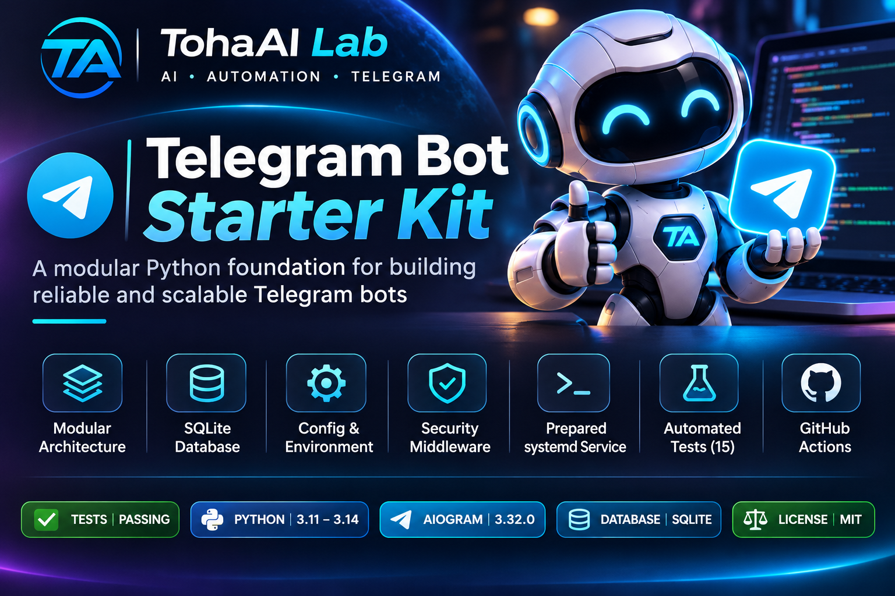

*Illustrative project banner.*

# Telegram Bot Starter Kit

### A modular Python foundation for Telegram bots

[](https://github.com/TohaAI-Lab/telegram-bot-starter-kit/actions/workflows/tests.yml)


Developed by **TohaAI Lab**.

An extensible starter application for building Telegram bots with Aiogram 3, SQLite, environment-based configuration, access control, and automated tests. The example bot demonstrates private-chat commands and persistent per-user statistics.

## Features

- Modular command handlers, business logic, storage, and middleware.
- Long polling with up to 16 concurrent update tasks.
- Persistent SQLite storage with atomic `/start` counters and UTC timestamps.
- Database operations offloaded to worker threads using `asyncio.to_thread`.
- Optional Telegram user ID allowlist and private-chat-only command handling.
- Input validation, token redaction in application logs, and sanitized error replies.
- Explicit webhook conflict check; existing webhooks are never deleted automatically.
- Managed HTTP session cleanup and an example systemd service for Linux.
- 15 offline unit and integration tests, with CI checks on Python 3.11–3.14.

## Requirements

- Python 3.11–3.14 (CI-tested versions).
- Git and Python's `venv`, `pip`, and `sqlite3` modules.
- A Telegram bot token from [@BotFather](https://t.me/BotFather) and internet access for live polling.
- Linux with systemd for the optional service deployment.

Direct dependencies: `aiogram==3.32.0` and `python-dotenv==1.2.4`. Transitive dependencies are resolved by pip.

## Quick Start

Use a separate test bot token, not a token belonging to an existing production bot. The following commands are for a Linux shell in a new, dedicated project directory.

```bash
git clone https://github.com/TohaAI-Lab/telegram-bot-starter-kit.git
cd telegram-bot-starter-kit
python3 -m venv .venv
.venv/bin/python -m pip install -r requirements.txt
cp .env.example .env
chmod 600 .env
```

Edit `.env` locally and replace `YOUR_BOT_TOKEN_HERE` with your own token. For a private test bot, set `ALLOWED_USER_IDS` to your Telegram user ID before starting it.

```bash
.venv/bin/python bot.py
```

Open a private chat with your bot in Telegram and send `/start`, `/help`, or `/status`. Stop the foreground process with Ctrl+C. Keep only one polling instance for the same token.

## Configuration

| Variable | Default | Description |
|---|---|---|
| `BOT_TOKEN` | Required | Token issued by BotFather. Format validation is local; it does not verify the token with Telegram. |
| `DATABASE_PATH` | `data/bot.sqlite3` | File-backed SQLite database. Relative paths are resolved against the project root. |
| `LOG_LEVEL` | `INFO` | `DEBUG`, `INFO`, `WARNING`, `ERROR`, or `CRITICAL`. |
| `ALLOWED_USER_IDS` | Empty | Comma-separated positive Telegram user IDs. Empty allows everyone in private chats. |

The application loads `.env` from the project root without overriding existing environment variables. Do not commit your actual `.env` or database files.

## Bot Commands

| Command | Behavior |
|---|---|
| `/start` | Sends a welcome message and increments the sender's persistent start count. |
| `/help` | Displays the supported commands. |
| `/status` | Shows application responsiveness and the requesting user's own start count. |

These commands are handled in private chats only. `/status` is not a comprehensive server or health monitoring endpoint. The timestamps in storage describe `/start` activity, not every interaction.

## Project Structure

```text
telegram-bot-starter-kit/
├── bot.py                              # Application entry point
├── config.py                           # Environment configuration
├── .env.example                        # Configuration template
├── .gitignore                          # Local and sensitive file exclusions
├── requirements.txt                    # Direct dependencies
├── database/
│   └── storage.py                      # Async SQLite operations
├── services/
│   └── bot_service.py                  # Telegram-independent business logic
├── handlers/
│   └── commands.py                     # Aiogram router and commands
├── middlewares/
│   └── security.py                     # Access and error handling
├── deploy/
│   └── telegram-bot-starter-kit.service # Example systemd unit
├── tests/
│   └── test_starter.py                  # Offline regression suite
├── .github/workflows/
│   └── tests.yml                       # CI matrix
├── README.md
└── LICENSE
```

## Architecture

```text
Telegram Bot API (long polling)
             |
        Dispatcher / Router
             |
     Error handling / Access control
             |
        Command handlers
             |
          BotService
             |
        SQLite storage
```

The dispatcher injects `BotService` into command handlers. To extend the example, add handlers to the router, keep application logic in the service layer, and add tests for new behavior. Apply access control to new routers or event types explicitly; the existing middleware covers matched message handlers on the starter router.

## Linux Deployment (systemd)

The example unit in `deploy/` is intended for a fresh, dedicated deployment. The following is a suggested setup for Ubuntu 24.04 or a comparable Linux host with Python 3.11–3.14 installed. It requires administrator privileges for installation, but the running bot uses an unprivileged account. Review the commands before use; do not apply them to an existing bot installation. Full service deployment has not yet been validated on a dedicated host.

Create the dedicated account and root-owned application directory. The account, destination, and unit name must not already be in use.

```bash
sudo useradd --system --user-group --no-create-home --shell /usr/sbin/nologin telegram-starter
sudo git clone https://github.com/TohaAI-Lab/telegram-bot-starter-kit.git /opt/telegram-bot-starter-kit
sudo python3 -m venv /opt/telegram-bot-starter-kit/.venv
sudo /opt/telegram-bot-starter-kit/.venv/bin/python -m pip install -r /opt/telegram-bot-starter-kit/requirements.txt
```

Prepare a restricted configuration file and edit it locally with your own token and desired allowlist:

```bash
sudo install -o root -g telegram-starter -m 0640 /opt/telegram-bot-starter-kit/.env.example /opt/telegram-bot-starter-kit/.env
sudoedit /opt/telegram-bot-starter-kit/.env
```

The supplied unit sets `DATABASE_PATH` to `/var/lib/telegram-bot-starter-kit/bot.sqlite3` through the environment. systemd creates the state directory with restricted permissions. This path takes precedence over the value in `.env`.

Review the example unit and then install and validate it:

```bash
sudo install -o root -g root -m 0644 /opt/telegram-bot-starter-kit/deploy/telegram-bot-starter-kit.service /etc/systemd/system/telegram-bot-starter-kit.service
sudo systemd-analyze verify /etc/systemd/system/telegram-bot-starter-kit.service
```

Only if validation succeeds and you are ready to start this new service, run:

```bash
sudo systemctl daemon-reload
sudo systemctl enable --now telegram-bot-starter-kit.service
sudo systemctl status telegram-bot-starter-kit.service
```

Inspect logs or stop only this service:

```bash
sudo journalctl -u telegram-bot-starter-kit.service -n 50 --no-pager
sudo systemctl stop telegram-bot-starter-kit.service
```

The template includes restart-on-failure, restart rate limits, a 40-second stop timeout, `NoNewPrivileges`, `PrivateTmp`, `ProtectSystem=strict`, and `ProtectHome=true`. Review these settings if adapting the template to other paths or applications.

## Automated Testing

After installing the dependencies, run from the project root:

```bash
.venv/bin/python -m unittest discover -s tests -v
```

The 15 tests cover configuration, SQLite persistence, concurrent writes, validation, UTC timestamps, service replies, real Aiogram dispatcher routing with mocked Telegram I/O, access control, sanitized errors, token redaction, polling options, and webhook conflict handling.

GitHub Actions installs the dependencies, checks Python syntax, and runs the suite on Ubuntu 24.04 with Python 3.11, 3.12, 3.13, and 3.14. CI fails if fewer than 15 tests run, any tests are skipped, or a test fails. All four jobs passed for commit `59666a5`.

The tests use synthetic tokens and temporary databases; they do not contact Telegram. If dependencies are missing, six integration tests are skipped during a local run; install the requirements to run the full suite.

[View CI results](https://github.com/TohaAI-Lab/telegram-bot-starter-kit/actions)

## Security and Privacy

- Keep bot tokens private. Rotate a token through BotFather if it is exposed.
- Set an explicit allowlist if the bot should not be publicly accessible.
- The example stores Telegram user IDs, `/start` counters, and first/last `/start` timestamps. It does not store names, phone numbers, or message contents in SQLite.
- Treat the database as personal data. Restrict access, manage retention and backups, and do not publish it.
- Application log formatting redacts the configured token and its URL-encoded form. Handler errors avoid raw exception text; this is not a guarantee that every possible third-party log or future extension is free of sensitive data.
- `.gitignore` helps prevent accidental commits of local files; it is not a secret-management system and does not remove files already tracked by Git.

## Current Limitations

- Early-stage starter application, not a production-ready bot platform.
- Live Telegram API operation and full systemd deployment have not yet been verified for this project.
- Long polling only; no webhook server, group commands, or callback-query handlers are provided.
- The SQLite schema is intentionally small; no migrations, retention controls, or backup automation are included.
- No rate limiting per user, multi-instance coordination, or distributed storage is provided.

## Contributing

Bug reports and improvements are welcome. Please use synthetic credentials and anonymized data in examples and issue reports. Run the full test suite before submitting changes.

## License

Distributed under the [MIT License](./LICENSE).

## About TohaAI Lab

Independent development focused on Python, Telegram bots, AI agents, browser automation, Linux tooling, and API integration.

[Visit TohaAI Lab on GitHub](https://github.com/TohaAI-Lab)

**Build. Automate. Improve.**
